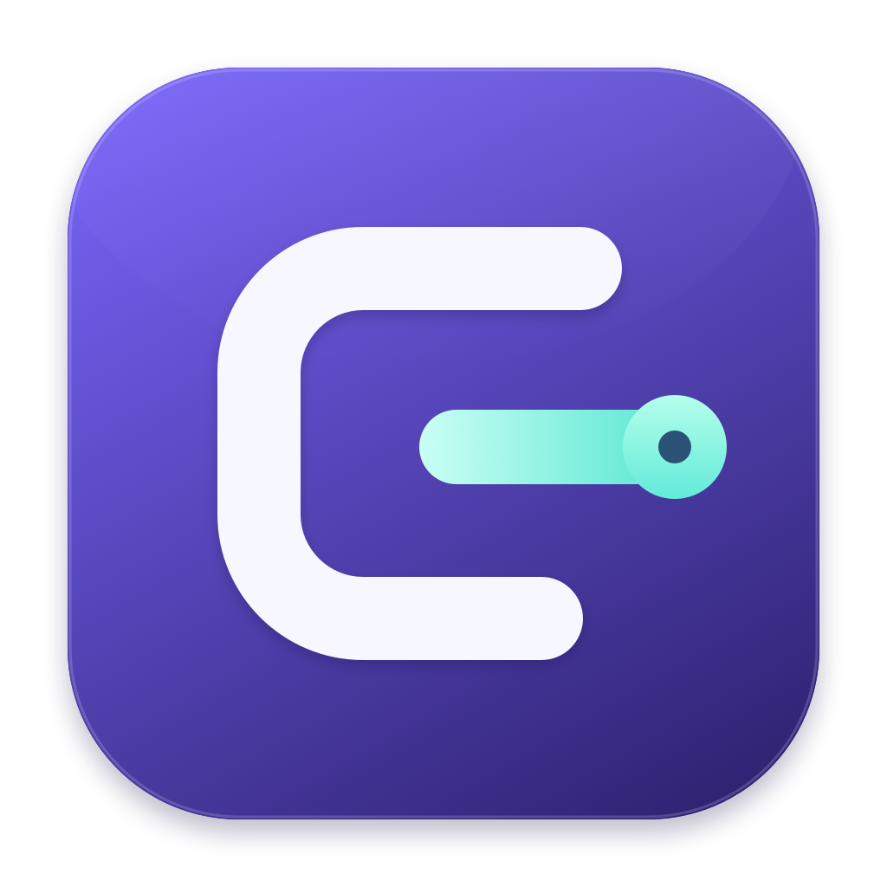
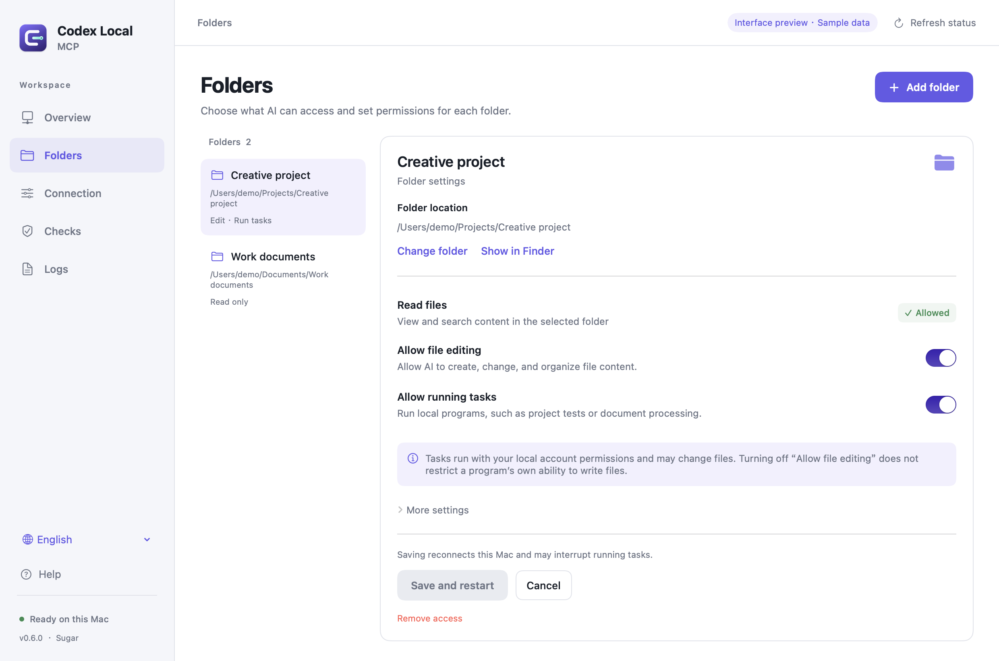
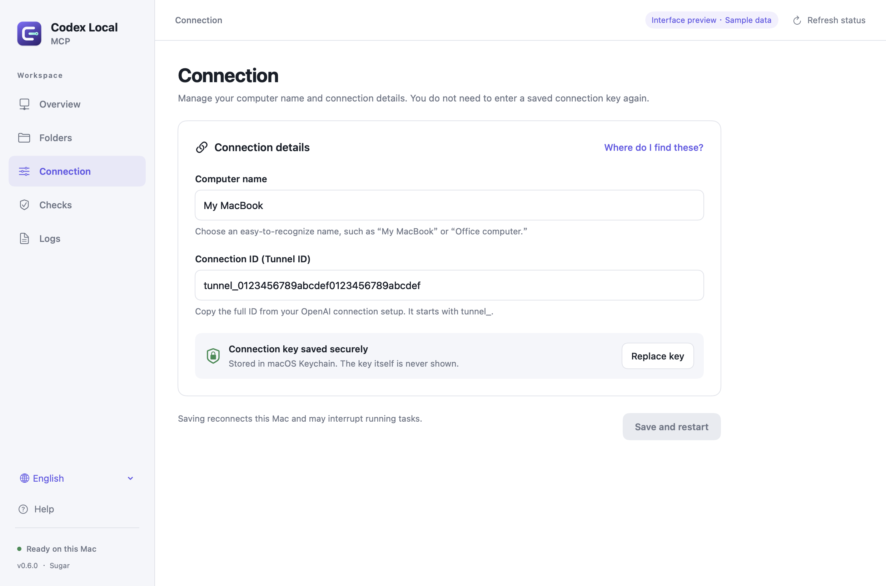

<p align="center">
  
</p>

<h1 align="center">Codex Local MCP</h1>

<p align="center"><strong>Your Mac. Your projects. Connected to ChatGPT.</strong></p>

<p align="center">
  A native macOS app for project folders, local tasks, and a connection you can understand.
</p>

<p align="center">
  <a href="https://github.com/makersns/codex-local-mcp/releases/latest"><strong>Download for macOS</strong></a> ·
  <a href="#quick-start">Quick start</a> ·
  <a href="#screenshots">Screenshots</a> ·
  <a href="https://github.com/makersns/codex-local-mcp/issues">Report an issue</a>
</p>

<p align="center">
  <a href="https://github.com/makersns/codex-local-mcp/releases"></a>
  
  
  
</p>

<p align="center">
  <strong>English</strong> · <a href="docs/README.zh-CN.md">简体中文</a> ·
  <a href="docs/README.zh-TW.md">繁體中文</a> · <a href="docs/README.ja.md">日本語</a>
</p>

---

Codex Local MCP gives your local connection a proper desktop home. Choose the folders AI may work with, decide which capabilities to allow, and manage the connection from one native window.

Built by [**Sugar**](https://sugar.makersns.com). This is an independent community project, not an official OpenAI application. It connects through the official Secure MCP Tunnel components.

## Why use it?

- **Configure with a native app.** Folder pickers, readable permissions, a single setup page, and useful recovery messages.
- **Work across projects.** Add up to 32 folders, each with its own file editing and command execution settings.
- **Understand connection activity.** See current tool activity, recently active conversations, and local tasks separately.
- **Keep credentials out of ordinary settings.** Runtime keys are stored in the macOS login Keychain. Existing keys can be reused.
- **Make changes deliberately.** Save changes together; drafts survive routine refreshes, and unsaved edits are protected when navigating or closing.
- **Troubleshoot in one place.** Check the local environment and view bounded, redacted runtime information.

Use ChatGPT to inspect a codebase, edit authorized files, run a test suite, start a development server, or work with local document tools. The capabilities available to a project depend on the permissions you enable and the software installed on your Mac.

## Screenshots


*Actual native app rendering with clearly marked example data. Both the app and the documentation support English, Simplified Chinese, Traditional Chinese, and Japanese.*

<details>
<summary><strong>Project folders and connection settings</strong></summary>

### Give each folder the access it needs



### Set up once, reuse your saved connection



</details>

## Quick start

### 1. Download and open the app

Get the universal macOS ZIP from [Releases](https://github.com/makersns/codex-local-mcp/releases/latest), extract it, and open **Codex Local MCP.app**.

The app installs into `~/Applications` and prepares its runtime. Prebuilt-app users do not need a compiler or terminal commands. Initial runtime preparation requires an internet connection.

### 2. Enter your connection information

Give your Mac a recognizable name, then enter the Tunnel ID and Runtime key. The app provides links and instructions.

You need an OpenAI Secure MCP Tunnel associated with the intended ChatGPT workspace. The Runtime key needs **Tunnels Read + Use** access for that tunnel. See the [official setup guide](https://developers.openai.com/api/docs/guides/secure-mcp-tunnels) and [plugin connection guide](https://developers.openai.com/plugins/deploy/connect-chatgpt). The app does not create the cloud tunnel or ChatGPT plugin for you.

### 3. Choose a project folder

Use the native folder picker. New folders allow file editing by default; command execution starts **off**. Existing permissions are preserved during upgrades. Project identifiers are generated automatically and can be adjusted under advanced settings.

### 4. Save and verify from ChatGPT

Click **Save and connect**. Select the matching connection in ChatGPT and ask it to list your configured workspaces or read a project README.

“Locally ready” confirms the Mac-side connection. A successful tool call confirms the complete path from ChatGPT to your Mac.

## Permissions, clearly separated

| Capability | What it allows | Default for a new folder |
| --- | --- | --- |
| Read files | Browse and read files through the workspace file tools | On |
| Edit files | Create and change files through those tools | On |
| Run local tasks | Execute commands, tests, development servers, and installed document tools | Off |

Commands run with the current macOS user's permissions and can modify files. Turning off file editing does not make an enabled command runner read-only. A configured workspace is not an operating-system sandbox.

Removing a folder removes its configured access; it does not delete the folder. Saving connection or folder changes can restart the connection, so finish running tasks first.

## Know what is active

The overview distinguishes three useful signals:

| Indicator | Meaning |
| --- | --- |
| Currently calling | Distinct identified conversations with a tool request still executing |
| Active in the last 10 minutes | Distinct identified conversations with recent or ongoing tool activity |
| Running tasks | Managed local commands that are still running |

These are activity measurements, not a promise that every idle chat window is still online. Missing conversation metadata is reported as an unidentified source instead of a misleading zero. Statistics begin with the current background service and reset when it restarts.

The activity view uses anonymous local labels. It does not need conversation titles or chat contents. See the [activity design and limitations](docs/SESSION_MONITORING_DESIGN.md).

## A few practical details

**Change the language without losing your work.** The app follows your system language by default. Use the language menu to choose English, Simplified Chinese, Traditional Chinese, or Japanese; your choice is remembered, drafts are preserved, and the background connection keeps running.

**Closing the window keeps the connection running.** Stop it explicitly from the overview when needed.

**Chrome is a separate integration.** Use ChatGPT's Chrome integration for webpage interaction and debugging. With multiple Macs, confirm that Chrome and the local connection point to the same device.

**Office checks are optional.** Environment checks and synthetic document tests help identify installed capabilities. They do not install Office or open your documents automatically.

**Upgrades keep existing configuration.** Folder access, connection settings, and Keychain identities remain compatible. Opening a new app version prepares its runtime without interrupting an existing connection. Apply it with an explicit restart after current work finishes.

**Each Mac needs its own tunnel.** Run one client instance for each stdio tunnel.

## Requirements and release status

| Item | Support |
| --- | --- |
| macOS | 13 or later |
| App architectures | Apple Silicon `arm64` and Intel `x86_64` |
| Hardware exercised | Apple Silicon; Intel binary also tested through Rosetta |
| App interface | English, 简体中文, 繁體中文, 日本語; follows the system or your saved choice |
| Documentation | English, 简体中文, 繁體中文, 日本語 |
| Signing | Ad-hoc signed; not Developer ID notarized |

If macOS blocks opening a downloaded build, use the normal **Privacy & Security → Open Anyway** flow after checking its source. The app does not disable macOS security controls.

The [validation report](VALIDATION.md) separates automated tests, native interaction checks, packaged-app verification, and limitations. [Release notes](RELEASE_NOTES.md) describe version changes.

## Build from source

Source builds require the macOS Command Line Tools, including Swift and the SDK.

```bash
git clone https://github.com/makersns/codex-local-mcp.git
cd codex-local-mcp
/bin/bash ./Install_Codex_Local_MCP.command
```

To build without installing, provide a new absolute output path:

```bash
/bin/bash ./build-macos.sh "$PWD/dist/Codex Local MCP.app"
```

The UI uses **SwiftUI + AppKit**. A bounded local JSON bridge connects it to the Python management layer; the app does not open a management HTTP port. The original Python module and command remain compatible, with an additional `codex-local-mcp` command.

For standalone MCP server setup, fixed Python dependencies, and transport options, see [server/README.md](server/README.md). For the scope of file and command permissions, see [security notes](server/docs/SECURITY.md).

## Feedback and contributions

[Open an issue](https://github.com/makersns/codex-local-mcp/issues) with your macOS version, app version, steps to reproduce, and redacted diagnostic information. UI feedback and improvements to the translations are welcome. Keep Runtime keys and private project contents out of reports.

If Codex Local MCP makes your local workflow easier, **a star helps other people find the project**.

[App icon and source artwork](docs/APP_ICON.md) · [Implementation notes](docs/IMPLEMENTATION_PLAN_0.6.0.md) · [Release verification](docs/RELEASE_0.6.0.md)
