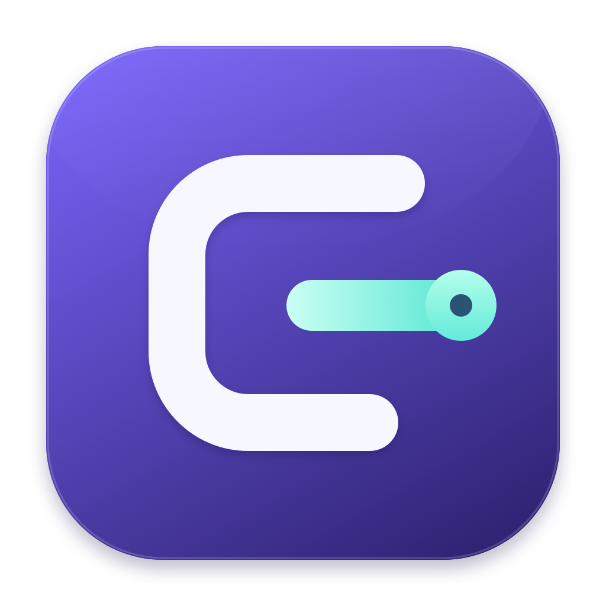
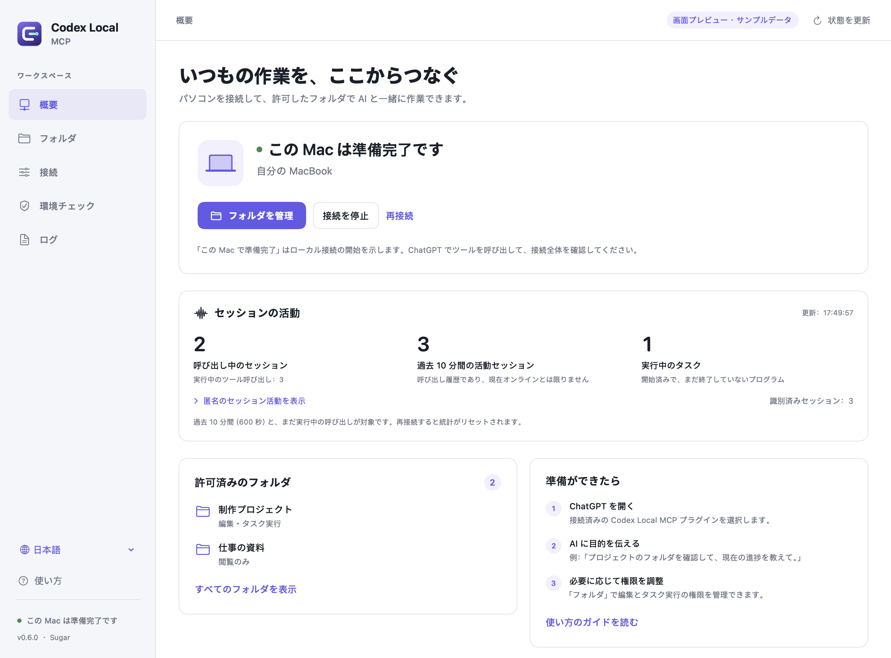
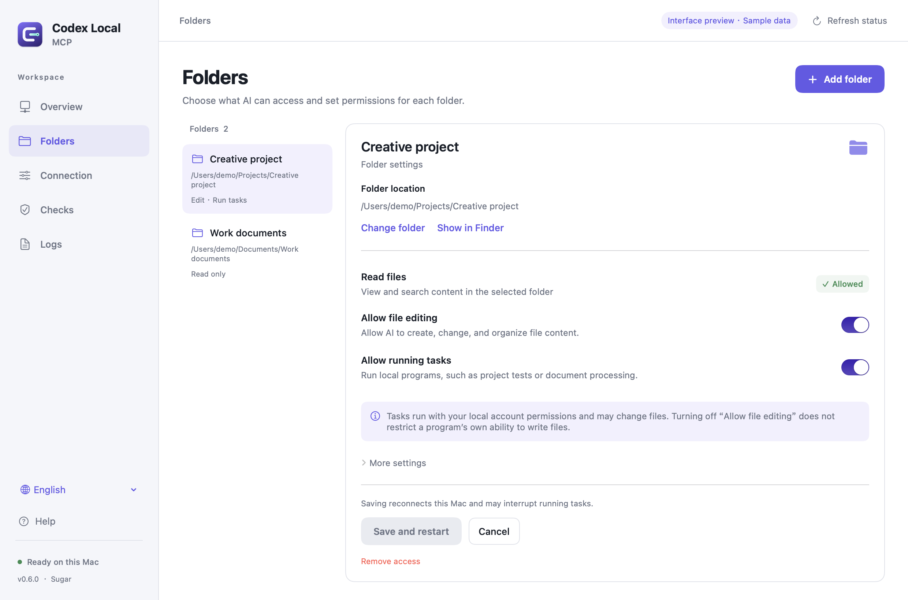
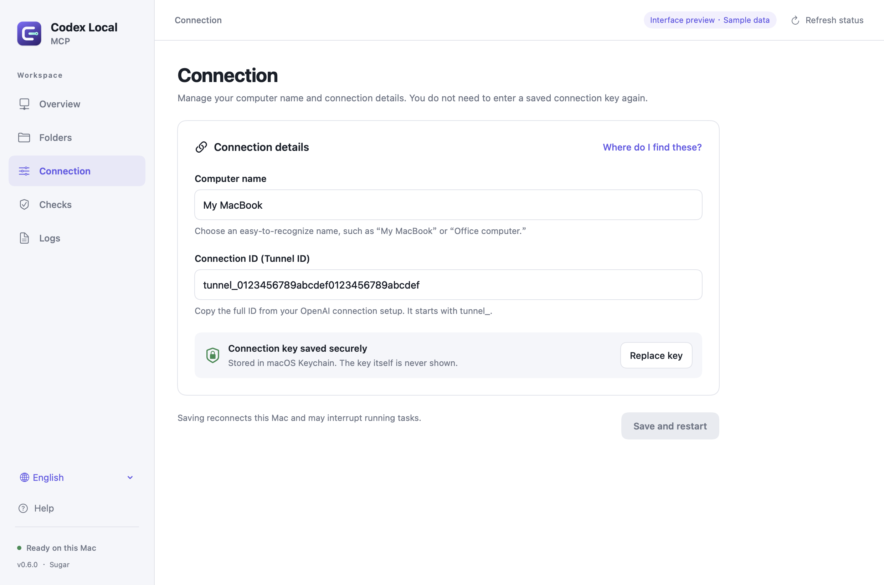

# Codex Local MCP

[English](../README.md) · [简体中文](README.zh-CN.md) · [繁體中文](README.zh-TW.md) · [日本語](README.ja.md)

**いつものフォルダを、AI と一緒に使える作業場所へ。**

Codex Local MCP は、ChatGPT から自分の Mac 上のファイルや開発環境を扱うための、macOS ネイティブアプリです。フォルダを選び、アクセス権限と接続情報を設定すると、文章の確認、コードの編集、テストの実行、ドキュメント処理などを依頼できます。ファイルを別の場所へ移す必要はありません。

作成者は [Sugar](https://sugar.makersns.com/) です。公式の `tunnel-client` を利用するコミュニティプロジェクトであり、OpenAI の公式クライアントではありません。

[最新の公開リリースをダウンロード](https://github.com/makersns/codex-local-mcp/releases/latest) · [ソースコード](https://github.com/makersns/codex-local-mcp)

## 毎日の作業を、ひとつのウィンドウから

接続状態、利用を許可したフォルダ、環境チェック、最近の実行ログを同じウィンドウで確認できます。プロジェクトIDは自動で作成されるため、普段の設定で技術的な識別子を入力する必要はありません。

| 画面 | できること |
| --- | --- |
| 概要 | 接続状態を確認し、開始・停止・再接続を操作 |
| フォルダ | フォルダの追加、場所の変更、権限の調整、アクセスの解除 |
| 接続 | Mac の表示名、接続 ID、接続用キーを設定 |
| 環境チェック | Excel・Word・PowerPoint の基本的な読み書き環境を確認 |
| ログ | 最近の動作や接続の問題を確認し、機密情報を除いた内容をコピー |

画面はアプリのサンプルデータを使ったプレビューです。実際のフォルダ名や接続情報は、利用する Mac に合わせて表示されます。

## 最初の接続は4ステップ

1. **アプリを開く。** リリースを展開し、`Codex Local MCP.app` を開きます。ユーザーの Applications フォルダへインストールされ、必要な実行環境が準備されます。初回の準備にはインターネット接続が必要です。
2. **接続情報を入力する。** Mac にわかりやすい名前を付け、OpenAI で作成した Tunnel ID と Runtime key を入力します。Runtime key には対象トンネルの Tunnels Read + Use 権限が必要です。[公式の接続ガイド](https://developers.openai.com/api/docs/guides/secure-mcp-tunnels)も参照できます。
3. **使いたいフォルダを選ぶ。** フォルダを選択し、ファイルの編集やコマンドの実行を許可するか確認して、保存して接続します。あとからフォルダと権限を変更できます。
4. **ChatGPT から確かめる。** 対応する MCP 接続を選び、「利用できるフォルダを一覧にして」と依頼し、README などを読ませます。アプリの準備完了表示はローカル側の状態です。実際のツール呼び出しが成功することで、接続全体を確認できます。

## 権限はフォルダごとに

新しいフォルダではファイルの編集を許可し、コマンドの実行は初期状態で無効にします。既存の設定を引き継ぐ場合は、それまでの権限を保ちます。アクセスを解除しても、ディスク上のファイルは削除しません。

コマンドは Mac にログインしているユーザーの権限で実行されるため、ファイルを変更することもできます。「ファイルの編集」をオフにしても、許可したコマンド自体の書き込み能力は制限されません。作業フォルダの指定は、OS のサンドボックスではありません。

## キーの入力は一度で

Runtime key は macOS のログインキーチェーンに保存します。既存のキーは再入力する必要がなく、内容を画面へ表示せずに保存状態を確認できます。キーを交換する場合は、接続画面から新しいキーを保存します。ChatGPT の会話へキーを貼り付ける必要はありません。

保存前の変更がある場合、画面を切り替える前に編集を続けるか、変更を破棄するか選べます。保存と再接続は明確な操作として行われ、入力中の変更だけで接続を再起動することはありません。

## 作業の動きを確かめる

概要の活動パネルには、**呼び出し中のセッション、過去10分間に活動があったセッション、実行中のタスク**を分けて表示します。これは観測できた活動の記録であり、オンラインのチャット総数を示すものではありません。古いバックエンドや取得できない状態では、未確認の件数をゼロとして表示しません。

## 言語とブラウザ

英語・簡体字中国語・繁体字中国語・日本語に対応しています。初期表示はシステム言語に合わせ、サイドバーの「表示言語」からいつでも切り替えられます。選択は保存され、入力中の変更を保ったまま反映されます。言語の変更だけで接続を再起動することはありません。

Web ページの操作には、ChatGPT の独立した Chrome 連携を利用します。Codex Local MCP はファイルとプロセスを扱い、Chrome 連携はページを操作します。複数の Mac を使う場合は、両方が同じ Mac に接続されていることを確認してください。

通常のファイル・ターミナル操作とこの Chrome 連携には、Codex Local MCP の画面収録やアクセシビリティ権限は不要です。アプリ内のシステム権限チェックは、必要な作業に対して手動で利用します。

## 対応環境とアップグレード

macOS 13 以降に対応し、配布アプリは Apple Silicon と Intel を含む Universal 構成です。実機検証の範囲は [検証記録](../VALIDATION.md)をご覧ください。現時点の署名は ad-hoc で、Apple Developer ID による公証は提供していません。macOS が起動を止めた場合は、配布元を確認したうえで、システムの「プライバシーとセキュリティ」に表示される操作に従ってください。

アップグレードでは、フォルダ、権限、接続設定、キーチェーンを引き継ぎます。新しい画面を開くだけで既存の接続を停止しません。進行中の作業が終わったら再接続し、ChatGPT 側のツールを更新してから、実際の呼び出しで確認してください。

[変更履歴](../RELEASE_NOTES.md) · [実行環境の説明](../docs_BOOTSTRAP.md) · [不具合を報告](https://github.com/makersns/codex-local-mcp/issues)
