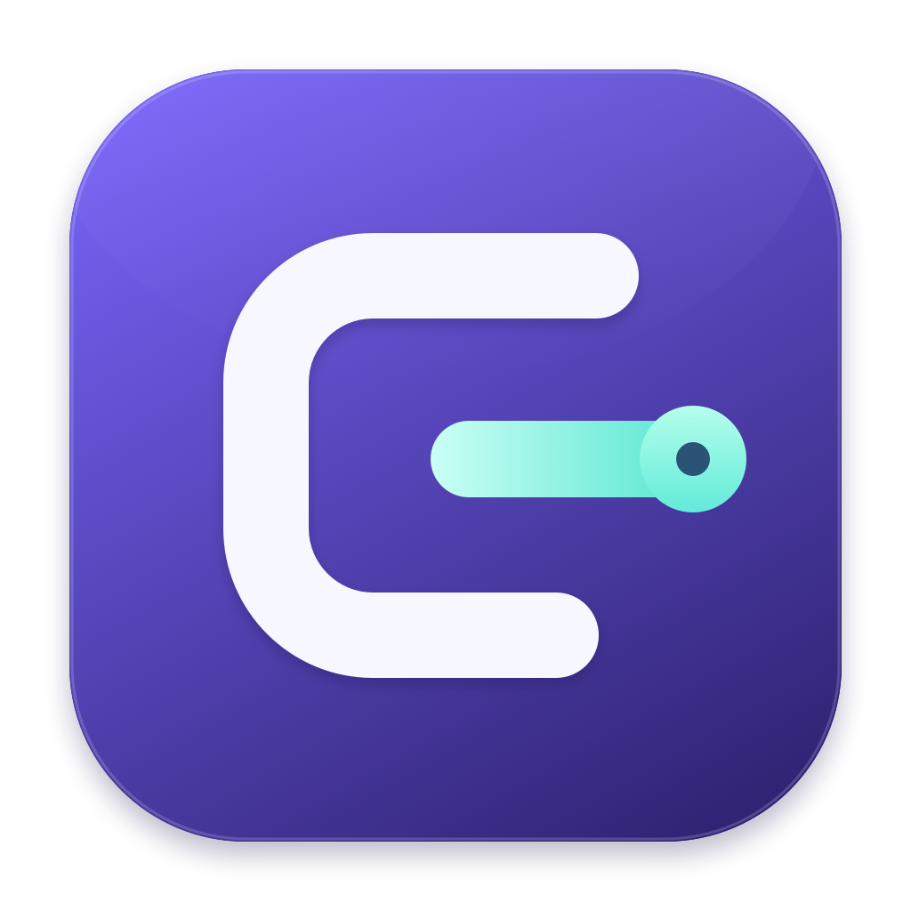
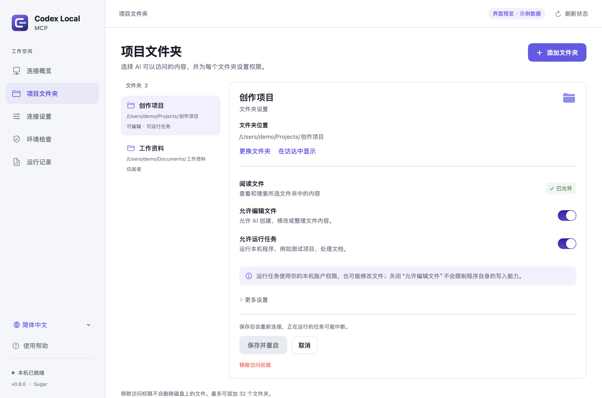
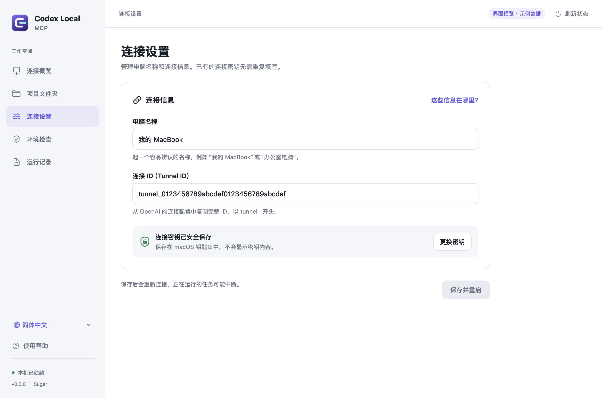

# Codex Local MCP

[English](../README.md) · **简体中文** · [繁體中文](README.zh-TW.md) · [日本語](README.ja.md)

**把项目留在本机，让 AI 接得上你的工作。**

用一个原生 macOS 窗口，连接 ChatGPT 与本机文件、开发项目和日常任务。选好文件夹、设置权限，就能让 AI 帮你阅读资料、修改文件、运行项目。无需为了管理连接反复切换终端和配置文件。

**0.6.0 · 作者 [Sugar](https://sugar.makersns.com/) · macOS 13+**

[下载最新版](https://github.com/makersns/codex-local-mcp/releases/latest) · [更新说明](../RELEASE_NOTES.md) · [验证记录](../VALIDATION.md)

由 Sugar 维护的社区项目，非 OpenAI 官方客户端。使用 OpenAI 的官方隧道组件；应用本身不调用模型 API。

*截图来自应用实际渲染，使用明确标注的示例数据。文档与客户端提供英语、简体中文、繁体中文和日语。界面默认跟随系统，可在左下角语言菜单切换，正在编辑的内容会保留。*

## 四步开始

1. **打开应用。** 下载并解压后打开 **Codex Local MCP.app**，应用自动安装到当前用户的 Applications，并准备运行环境。首次准备需要网络。
2. **填写连接信息。** 按[官方连接指南](https://developers.openai.com/api/docs/guides/secure-mcp-tunnels)准备 Tunnel ID 和具备目标隧道 **Tunnels Read + Use** 权限的 Runtime key，在“连接设置”填写电脑名称与连接信息。
3. **选择文件夹。** 直接选择工作目录，项目标识自动生成。新目录默认允许编辑，运行任务默认关闭；需要执行程序时再开启。
4. **保存并验证。** 点击“保存并连接”，本机就绪后回到 ChatGPT 选择对应连接，实际调用一次列目录或读取文件工具，确认完整链路。

已有用户可沿用原来的文件夹、权限和钥匙串密钥。关闭窗口不会停止后台连接；保存设置并重启时，正在执行的任务可能中断。

## 把常用操作放在眼前

- **会话活动：** 概览显示正在调用、近 10 分钟活跃会话和运行中任务，可展开匿名明细；未识别来源或统计不可用会明确标注，重新连接后重新统计。
- **项目文件夹：** 添加、更换、调整权限和移除访问，支持中文与空格路径；移除访问不会删除磁盘文件。
- **连接设置：** 密钥保存在 macOS 钥匙串，已有密钥无需重复输入。
- **环境检查：** 手动检查文档处理能力，基础验证使用样例文件。
- **运行记录：** 查看最近的脱敏信息，便于定位问题与反馈。

## 权限与兼容性

“允许编辑文件”控制文件工具的写入能力；“允许运行任务”允许程序使用当前 macOS 用户权限运行，也可能修改所选文件夹以外的文件。关闭编辑权限不会让这些程序变成只读，项目目录不构成操作系统沙箱。

Chrome 使用 ChatGPT 的**独立浏览器集成**，需要另行连接。普通文件、终端和独立 Chrome 集成不要求本应用获得屏幕录制或辅助功能权限。

提供 **arm64 + x86_64 通用应用**，最低 macOS 13。Intel 架构已通过 Rosetta 验证，尚未在 Intel 真机测试。当前安装包使用 ad-hoc 签名，未完成 Apple 公证；首次打开遇到系统限制时，请参考[安装说明](../INSTALL.html)。

## 源码与交流

源码构建需要 macOS Command Line Tools。在仓库根目录执行：

~~~bash
/bin/bash ./build-macos.sh "$PWD/dist/Codex Local MCP.app"
/bin/bash ./install-app.sh "$PWD/dist/Codex Local MCP.app"
~~~

构建输出路径须尚不存在。[架构与连接说明](../server/README.md) · [安全边界](../server/docs/SECURITY.md) · [图标设计与源文件](APP_ICON.md)

如果它帮你省下了整理文件或调试项目的时间，欢迎点亮 Star。遇到问题或有改进建议，欢迎[提交 Issue](https://github.com/makersns/codex-local-mcp/issues)，附上版本、复现步骤和脱敏记录；请勿上传密钥或私人资料。
