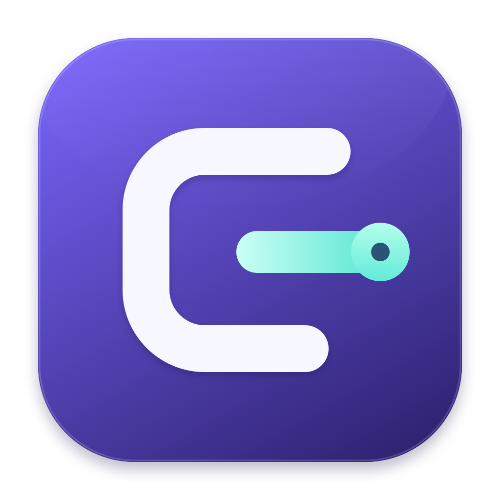
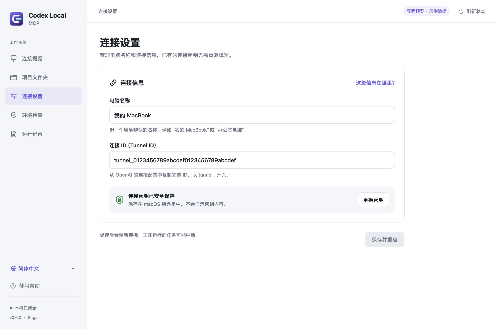

# Codex Local MCP

[English](../README.md) · [简体中文](README.zh-CN.md) · **繁體中文** · [日本語](README.ja.md)

**讓專案留在自己的電腦，讓 AI 接得上你的工作。**

透過一個原生 macOS 視窗，連接 ChatGPT 與本機檔案、開發專案和日常工作。選好資料夾、設定權限，就能讓 AI 協助閱讀資料、修改檔案及執行專案。管理連線時，不必反覆切換終端機與設定檔。

**0.6.0 · 作者 [Sugar](https://sugar.makersns.com/) · macOS 13+**

[下載最新版](https://github.com/makersns/codex-local-mcp/releases/latest) · [更新說明](../RELEASE_NOTES.md) · [驗證紀錄](../VALIDATION.md)

由 Sugar 維護的社群專案，並非 OpenAI 官方用戶端。使用 OpenAI 的官方通道元件；應用程式本身不呼叫模型 API。

*截圖由應用程式實際繪製，採用明確標示的範例資料。文件與用戶端提供英語、簡體中文、繁體中文和日語。介面預設跟隨系統，可在左下角語言選單切換，正在編輯的內容會保留。下方資料夾與設定截圖示範簡體中文介面。*

## 四步開始

1. **開啟應用程式。** 下載並解壓縮後開啟 **Codex Local MCP.app**，程式會自動安裝至目前使用者的 Applications，並準備執行環境。首次準備需要網路連線。
2. **填寫連線資訊。** 依照[官方連線指南](https://developers.openai.com/api/docs/guides/secure-mcp-tunnels)準備 Tunnel ID，以及具有目標通道 **Tunnels Read + Use** 權限的 Runtime key，在「連線設定」填寫電腦名稱及連線資訊。
3. **選擇資料夾。** 直接選擇工作目錄，專案識別碼會自動產生。新資料夾預設允許編輯，執行工作預設關閉；需要執行程式時再開啟。
4. **儲存並驗證。** 按「儲存並連線」，待本機就緒後，回到 ChatGPT 選擇對應連線，實際呼叫一次列出目錄或讀取檔案工具，確認完整連線。

既有使用者可沿用原本的資料夾、權限與鑰匙圈金鑰。關閉視窗不會停止背景連線；儲存設定並重新連線時，正在執行的工作可能中斷。

## 常用操作，一目了然

- **對話活動：** 概覽顯示正在呼叫、近 10 分鐘活躍對話及執行中的任務，可展開匿名明細；來源無法識別或統計暫不可用時會清楚標示，重新連線後重新統計。
- **專案資料夾：** 新增、更換、調整權限與移除存取，支援中文及空格路徑；移除存取不會刪除磁碟上的檔案。
- **連線設定：** 金鑰保存在 macOS 鑰匙圈，已儲存的金鑰無須重複輸入。
- **環境檢查：** 手動檢查文件處理能力，基礎驗證使用範例檔案。
- **執行紀錄：** 查看近期已遮蔽敏感資訊的紀錄，方便排查問題與回報。

## 權限與相容性

「允許編輯檔案」控制檔案工具的寫入能力；「允許執行任務」允許程式以目前 macOS 使用者權限執行，也可能修改所選資料夾以外的檔案。關閉編輯權限不會讓這些程式變成唯讀，專案目錄並非作業系統沙箱。

Chrome 使用 ChatGPT 的**獨立瀏覽器整合**，需要另外連接。一般檔案、終端機與獨立 Chrome 整合，不要求本應用程式取得螢幕錄製或輔助使用權限。

提供 **arm64 + x86_64 通用應用程式**，最低需求為 macOS 13。Intel 架構已透過 Rosetta 驗證，尚未在 Intel 實機測試。目前安裝包採用 ad-hoc 簽署，尚未完成 Apple 公證；首次開啟遇到系統限制時，請參考[安裝說明](../INSTALL.html)。

## 原始碼與交流

從原始碼建置需要 macOS Command Line Tools。請在儲存庫根目錄執行：

~~~bash
/bin/bash ./build-macos.sh "$PWD/dist/Codex Local MCP.app"
/bin/bash ./install-app.sh "$PWD/dist/Codex Local MCP.app"
~~~

建置輸出路徑必須尚不存在。[架構與連線說明](../server/README.md) · [安全邊界](../server/docs/SECURITY.md) · [圖示設計與原始碼](APP_ICON.md)

如果它幫你省下了整理檔案或除錯的時間，歡迎給專案一顆 Star。有問題或改善建議，歡迎[提交 Issue](https://github.com/makersns/codex-local-mcp/issues)，附上版本、重現步驟與已遮蔽敏感資訊的紀錄；請勿上傳金鑰或私人資料。
